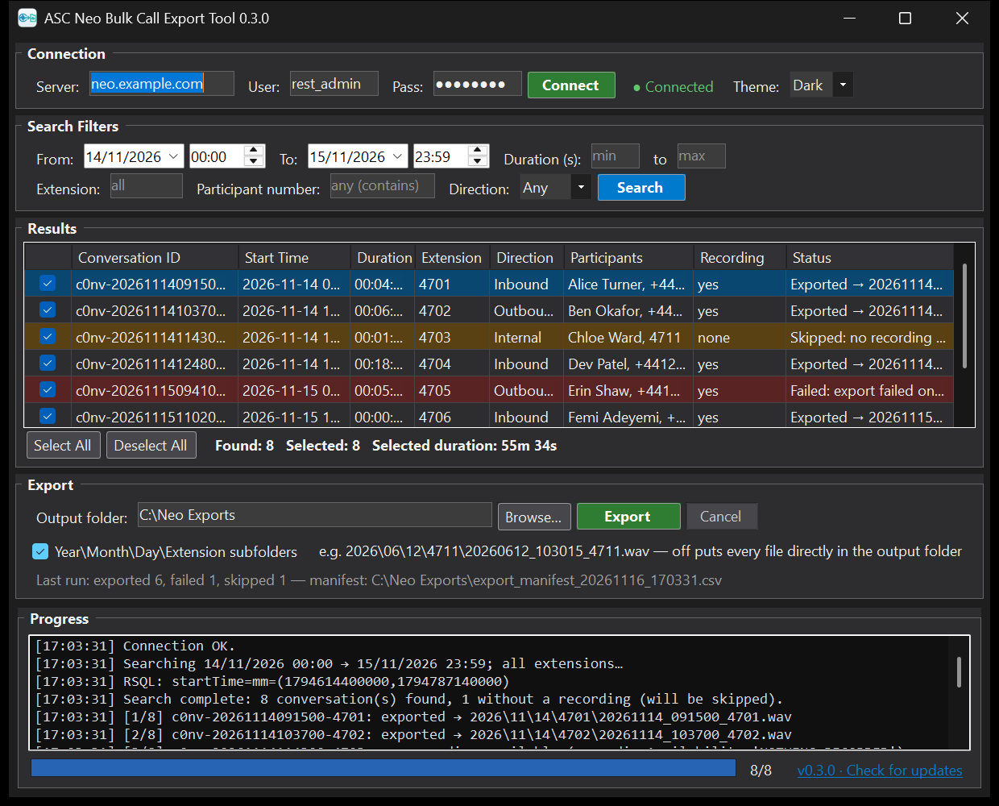

# ASC Neo Bulk Call Export Tool

`NeoBulkExportTool.exe` is a Windows tool that downloads a batch of call recordings from ASC Neo in
one pass. You pick a date and time range (and, optionally, an extension, a number, a direction or
a call length), the tool finds every matching call, and it exports the ones you tick one at a time
as WAV files, each with a small CSV describing the call. If one recording is broken or missing, it
is logged and the rest of the batch still finishes.

This repository holds the published releases only. Download the latest from
[Releases](../../releases/latest). Once it is on your PC, the tool keeps itself up to date (see
[Updates](#updates)).



- [What you need](#what-you-need)
- [Install](#install)
- [Export recordings](#export-recordings)
- [What you get](#what-you-get)
- [Updates](#updates)
- [Where things are stored](#where-things-are-stored)
- [Troubleshooting](#troubleshooting)

## What you need

On the PC:

- **Windows 10 or 11 (64-bit).** Nothing else needs installing: the exe includes everything it
  needs, which is why it is about 50 MB.
- **Network access to the Neo server** over HTTPS (port 443) and to its replay server (port 4040
  unless your system has been set up differently). Self-signed certificates are accepted.
- **Internet access to GitHub** for automatic updates (optional; see [Updates](#updates)).

On the Neo system (a tenant system administrator sets these up once, in System Configuration):

- **Neo 7.3 or later.** The tool fetches recordings through Neo's replay server connection, which
  the Web Service offers from version 7.3.
- **Web Service switched on for the tenant.** In the **Tenants** module, select the tenant, open
  the **Web Service** tab and tick the general gate ("Checks the general web service
  functionality").
- **Two Web Service methods granted** on the same tab: the one that allows searching for
  conversations, and the one that lets a client open a connection to the replay server (ASC's
  documentation calls it the *socket connection*).
- **A tenant superuser account**, used with its local Neo password. The account must be allowed to
  replay the calls you want and to save them as WAV: the tool can only fetch what that user could
  play back and save in POWERplay Web.

A login that works in POWERplay Web proves nothing about the Web Service, which is switched off by
default. If something is missing, **Connect** tells you which part (see
[Troubleshooting](#troubleshooting)).

## Install

1. Download `NeoBulkExportTool.exe` from the [latest release](../../releases/latest).
   Optionally check it against the release's `NeoBulkExportTool.exe.sha256` by running
   `Get-FileHash NeoBulkExportTool.exe` in PowerShell. The two values should match.
2. Put it in a folder **you can write to**, for example `Documents\Neo Export Tool` or your
   Desktop. Updates replace the exe in that folder, which is not possible under
   `C:\Program Files` without administrator rights.
3. Double-click it to start. The first time, Windows may show *"Windows protected your PC"*
   because the exe is not code-signed. Click **More info**, then **Run anyway**. Updates
   installed by the tool itself do not ask again.

There is no installer and nothing to uninstall: to remove the tool, delete the exe and the folder
`C:\ProgramData\ASC Neo Bulk Export Tool`.

## Export recordings

1. Enter the Neo server address, your user name and password, and press **Connect**. The server
   address is remembered for next time; the user name and password never are.
2. Set **From** and **To**. Optionally narrow the search:

   | Filter | How it works |
   |--------|--------------|
   | **Duration (s)** | Shortest and longest call length in seconds. Leave either box empty for no limit. |
   | **Extension** | Every call that extension took part in, including calls that arrived through a queue and were answered there. |
   | **Participant number** | Any part of any party's number, internal or external. Type the digits you are sure of rather than a full formatted number. |
   | **Direction** | Inbound, outbound or internal. |

3. Press **Search**. Matching calls fill the list, each one ticked. A row shown in amber has no
   recording and will be skipped. Untick anything you do not want, or use **Select All** /
   **Deselect All**.
4. Choose an **Output folder**. Leave **Year\Month\Day\Extension subfolders** ticked to sort the
   recordings into a folder per day and extension, or untick it to put every file directly in
   the output folder.
5. Press **Export** and confirm. The log and the progress bar show the run; each row's **Status**
   says whether that call was exported, failed or skipped, and failed rows turn red.
6. When the run finishes, a summary gives the counts and offers to open the output folder.

**Cancel** stops a run straight away. The call in progress is abandoned (its half-written file is
deleted) and every call after it is marked skipped, so you can run those again later.

A search by extension, participant number or direction checks every call in the date range, so
over a busy day it can take a minute. Neo cannot reliably search by extension itself: a call
answered through a queue is filed under the queue's number, not the agent's. Narrowing the date
range is the way to speed it up.

## What you get

For every exported call, two files named from the call's date, time and extension:

```
2026\01\15\4711\20260115_093000_4711.wav
2026\01\15\4711\20260115_093000_4711.csv
```

The `.wav` is the recording. The `.csv` next to it is a one-row sheet about that call: who was on
it, when it started and ended, how long it lasted, its direction, and any custom call parameters.

Each run also writes one `export_manifest_<date>_<time>.csv` at the top of the output folder. It
lists every call you selected, whether it was exported, failed or skipped, why, and where the file
went. It is the record of the run, and the place to look for calls that need another try.

Files are never overwritten. If a name is already taken, the tool adds `_2`, `_3` and so on.

## Updates

Updates are automatic:

1. Each time the tool starts, it checks this repository for a newer release.
2. If there is one, it downloads it in the background and checks it against the release's SHA-256
   checksum. You can keep working while this happens.
3. The link at the bottom right of the window changes from the version number to
   **Update available**, then to **ready — restart to install**. Click it to restart into the new
   version straight away, or just carry on: the update installs itself when you close the tool,
   and the next time you open it you are on the new version.

Your settings are kept. If anything goes wrong (no connection, a failed checksum), the current
version simply carries on. An update is never installed in the middle of an export.

- **Check by hand:** click the version link at the bottom right (**v0.3.0 · Check for updates**).
- **If the exe's folder is not writable** (for example `C:\Program Files` or a read-only network
  location), the tool cannot replace itself. It then offers to open the release page so you can
  download the new version yourself. Moving the exe to a folder you can write to fixes this.
- **Network:** outbound HTTPS to `api.github.com`, `github.com`,
  `objects.githubusercontent.com` and `release-assets.githubusercontent.com`. If these are
  blocked, which is common on a recording server, the tool works normally but does not update.
  Download new versions from [Releases](../../releases) instead.
- **Nothing about you or your system is sent.** The check is a plain request for the latest
  release of this repository.

## Where things are stored

```
C:\ProgramData\ASC Neo Bulk Export Tool\settings.cfg    server address, last output folder, theme
```

That file is shared by everyone who uses the tool on the PC. User names and passwords are never
written anywhere. Recordings go only to the output folder you choose.

## Troubleshooting

| Symptom | Likely cause | What to do |
|---------|--------------|------------|
| "Windows protected your PC" on first run | The exe is not code-signed | **More info → Run anyway** |
| Connect fails with HTTP 401 although the login works in POWERplay Web | The Web Service is not switched on for the tenant, a method is not granted, or the account is not a tenant superuser | The log shows a short diagnostic naming the layer that failed; see [What you need](#what-you-need) |
| Connect fails with "not found" | The Neo version has no REST Web Service | Neo 7.3 or later is needed |
| Search works but every export fails with "Could not log in to a replay server" | The replay server's port is not reachable from this PC, or the socket connection method is not granted | The message lists each address tried and why it failed |
| An export fails with a message from the replay server | The replay server could not build that recording | The **Status** column is often cut short: right-click the row and choose **Copy status text** for the whole message |
| A search by extension is slow | Every call in the date range has to be checked | Narrow the date range |
| The update link opens a web page instead of updating | The exe's folder is not writable | Move the exe to a folder you can write to (see [Install](#install)) |
| No update although a new release exists | GitHub is not reachable from this PC | Download the new exe from [Releases](../../releases) |
